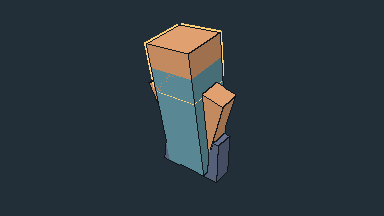
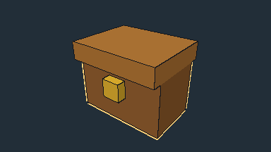
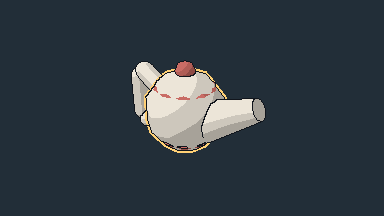
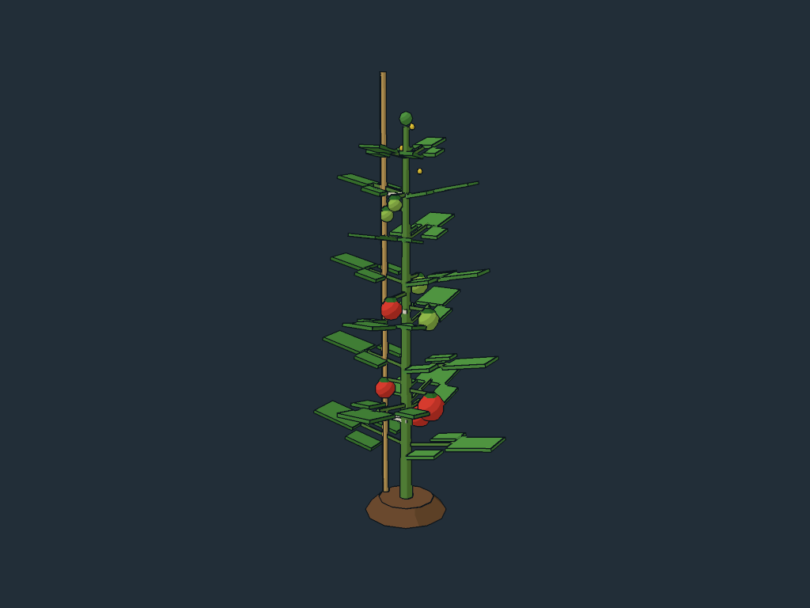

# つみき - Tsumiki Modeler

> ドット絵の3Dモデラー ／ A pixel-art 3D modeler

- 公開先：https://uraraworks.github.io/tsumiki-modeler/

## これは何か

箱・円柱・円錐台・球・カプセルといったプリミティブと、そこから変換したメッシュを組み合わせて、384×216 という低解像度でドット絵テイストのキャラクターやオブジェクトを作る3Dモデラーです。ブラウザだけで動き、ビルドは不要です。

**まだプロトタイプです。** 一通りの造形・テクスチャ・ボーンアニメーション・glTF（静的メッシュ）の書き出しは動きますが、UI や仕様は今後も変わります。ドット絵向けだけでなく、野菜・木・小屋のようなローポリモデルを作って他のアプリ（例：家庭菜園記録アプリ）へ持ち出す用途にも使えます。

## 作例

いずれも本ツールの `render_preview`（MCP経由のレンダリング機能）で撮った、実際の 384×216 描画結果です。作り込み具合はサンプルごとに異なります。

| | | |
|---|---|---|
|  |  |  |
| 人型サンプル | 宝箱サンプル | ティーポットサンプル（球と円錐台で構成） |

### ローポリ素材のお手本

| | |
|---|---|
|  | 「トマトの株」：支柱つき・高さ約1.2m（1単位＝1cm）。葉・実・花はすべて単色パーツ。`render_preview` の `smooth` 1024x768 で撮影。<br>[ModelDoc JSON](samples/tomato-plant.json) / [glTF（.glb）](samples/tomato-plant.glb)。`node tools/make-tomato-sample.mjs` で再生成できます |

## できること

- **形状**: 箱・円柱・円錐台・球・カプセル・メッシュ
- **編集**: 移動・回転・面ハンドルでのリサイズ・複製・左右ミラー
- **メッシュ編集**: 箱や曲面プリミティブからメッシュへの変換、面の押し出し、頂点の移動、パーツの結合、頂点の溶接
- **テクスチャ**: 面ごとの自動UV展開、モデル上への直接ドット打ち（ペン・消しゴム・スポイト）、固定パレット
- **ボーンとFKアニメーション**: ボーンの親子階層、パーツの剛体割り当て、キーフレームとタイムライン、回転はQuaternionのslerpで補間
- **描画**: 384×216固定＋整数倍拡大（端数は黒帯）、3段階トゥーンシェーディング、深度＋法線のエッジ検出による1pxアウトライン（選択パーツは黄色の輪郭を追加表示）
- **パーツの単色（ベタ塗り）**: テクスチャを描かず、パーツごとにパレットまたは任意の `#RRGGBB` で塗れます。「単色／テクスチャ」はパーツごとに切り替えでき、従来のテクスチャ機能と共存します（コマンド `setSolidColor`・`setColorMode`）
- **なめらか表示**: ビュー上部の「ドット／なめらか」で切り替え。なめらかはウィンドウ解像度・2倍スーパーサンプリングのアンチエイリアス付きで、3段トゥーンとエッジ検出の輪郭線（解像度に応じて1〜2px相当）はそのまま使います
- **細かい寸法**: 座標は整数グリッドのまま、「1単位＝何cm」（`unitCm`）を設定して実寸で扱えます（例：1単位＝1cmで高さ120単位の株＝1.2m）。ツールバーで移動・リサイズの刻み（`grid`）も切り替えられ、全体の実寸を表示します
- **glTF（.glb）書き出し**: ツールバーの「glTF書出」またはMCPの `export_gltf`。パーツごとに1ノード（名前＝パーツ名）・ワールド座標、単色は頂点カラー `COLOR_0`、ドットを描いたパーツはテクスチャ埋め込み。`unitCm` からメートル換算します。ボーン・アニメーションは対象外（静的メッシュ）
- **保存**: JSONでの保存・読込
- **MCP対応**: AIエージェントからモデルの取得・コマンド適用・検証・384×216プレビュー取得ができます。詳細は [mcp/README.md](mcp/README.md) を参照してください

今後の課題として、glTF へのボーン・アニメーション出力は未実装です（設計メモは [docs/開発ログ.md](docs/開発ログ.md) 参照）。

## 使い方

このディレクトリで以下を実行し、`http://localhost:8000/` を開きます。

```sh
python3 -m http.server 8000
```

Three.js 0.169.0 を CDN から読み込むため、インターネット接続とWebGL対応ブラウザが必要です。GitHub Pages にはファイルをそのまま配置できます。

マウス操作は Three.js の OrbitControls です。左ドラッグで回転、ホイールでズーム、右ドラッグでパンします。

### キーバインド

| キー | 動作 |
|---|---|
| `W` | 移動モードにする（ボーンモード中はボーンの移動ツール） |
| `E` | 回転モードにする（ボーン／アニメーションモード中は回転ツール） |
| `R` | リサイズモードにする |
| `P` | ペイントモードにする |
| `B` | ボーンモードを切り替える |
| `A` | アニメーションモードを切り替える |
| `F` | メッシュ編集モード（面選択）にする |
| `1` / `2` | メッシュ編集モード中、頂点サブモード／面サブモードを切り替える |
| `Ctrl`/`Cmd` + `D` | 選択パーツを複製する |
| `Space` | アニメーションモード中、再生・停止を切り替える |

複製・左右ミラー・削除・結合・溶接・メッシュ変換・Undo/Redo はツールバーのボタンから操作します（キーバインドはありません）。

## 設計の考え方

- **ModelDoc**（1つのJSON）が唯一の真実で、Three.js のシーンはその派生物です。逆方向には状態を持ちません
- **すべての編集はコマンド経由**で行われます。これが Undo/Redo と MCP 対応の土台になっています
- 座標と寸法は**整数グリッド**単位です
- 拡大は必ず**整数倍**で、端数は黒帯（レターボックス）で埋めます

### glTF 書き出しの仕様

- パーツ1つ＝メッシュ1つ＝ノード1つ。位置・回転は頂点へ焼き込んだワールド座標で、ノードは恒等変換です。Y-up・右手系（Three.js と同じ）
- 単位：書き出し時の既定は `unitCm`（未設定なら 1単位＝1m）。`metersPerUnit` で上書きできます
- 色：単色パーツは白いマテリアル＋ `COLOR_0`（リニア値）。ドットを描いたパーツは「`.` をパーツ色で埋めた」PNG を埋め込み、`COLOR_0` は白（二重に掛からないようにするため）。`vertexColors: false` ならマテリアルの `baseColorFactor` にパーツ色を入れます（頂点カラーを読まない環境向け）
- 書き出しは DOM に依存しない `src/gltf-export.js` で行い、ブラウザと Node で同じ結果になります

## テスト

```sh
npm install   # テスト用の three だけ入ります（アプリ本体はビルド不要）
npm test
```

`tests/gltf-export.mjs` は書き出した glb を GLTFLoader で読み戻して、頂点数・ノード名・色・スケール・テクスチャを検証します。

## 技術構成

ビルドツールなしの素の HTML + ES Modules で、Three.js は CDN（jsdelivr）から importmap で読み込みます。Node.js は MCPサーバーとテスト実行にのみ使用します。

## 開発の記録

- [docs/作業計画.md](docs/作業計画.md): 段階計画と設計判断
- [docs/開発ログ.md](docs/開発ログ.md): 実装の経緯

### フッターの版表示

画面下部のフッターに `つみき 2026-09-07 18:46 JST (4fa9a31)` のような版文字列を表示しています。姉妹プロジェクト WebNP2 は Vite の define でビルド時に埋め込みますが、つみきモデラーはビルドツールを持たないため、`node tools/update-version.mjs` を手動実行して `src/version.js`（gitにコミットする自動生成ファイル）を生成し、`src/main.js` がそれを import する方式にしています。整形ロジックは `tools/version.mjs` に純関数として分離してあり、`tests/version.mjs` で検証しています。

**制約**: この方式では、`node tools/update-version.mjs` を実行した時点の HEAD のハッシュが埋め込まれます。つまり「その生成物を含むコミット自身のハッシュ」にはなりません（自己参照になるため原理的に不可能です。`--amend` で含め直しても、コミットの内容が変わることでハッシュも変わってしまうため解決しません）。**表示されるのは直前のコミットを指す版**と理解してください。どのビルドを見ているかの識別には十分に機能します。また作業ツリーが汚れている（コミットされていない変更がある）場合はハッシュの末尾に `+` が付きます。

## ライセンス

[MIT License](LICENSE)

---

© URARA-works
